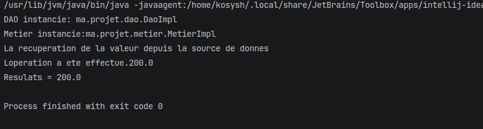

# TP1 — Injection de Dépendances par Réflexion Java

---

## Structure du projet

```
src/
└── main/
    ├── java/ma/projet/
    │   ├── dao/
    │   │   ├── IDao.java           # Interface : contrat de récupération de données
    │   │   └── DaoImpl.java        # Implémentation : simule une source de données
    │   ├── metier/
    │   │   ├── IMetier.java        # Interface : contrat de calcul
    │   │   └── MetierImpl.java     # Implémentation : effectue le calcul
    │   └── presentation/
    │       └── Presentation2.java  # Point d'entrée : charge, injecte, et exécute
    └── resources/
        └── config.txt              # Contient les noms des classes à utiliser
```

---

## Résultat d'exécution




> **DAO instancie: ma.projet.dao.DaoImpl**
Le programme a lu le fichier `config.txt` et a créé automatiquement
un objet `DaoImpl` grâce à la réflexion, sans l'écrire directement dans le code.

> **Metier instancie: ma.projet.metier.MetierImpl**
De la même façon, un objet `MetierImpl` a été créé dynamiquement
depuis le nom de classe lu dans `config.txt`.

> **La recuperation de la valeur depuis la source de donnes**
Le DAO a été injecté dans le Métier via son setter `setDao()`.
Quand `calcul()` est appelé, le Métier demande au DAO de lui donner
une valeur — ici il simule une base de données et retourne `100.0`.

> **Loperation a ete effectue. 200.0**
Le Métier reçoit `100.0` et effectue le calcul : `100.0 × 2 = 200.0`.

> **Resulats = 200.0**
Le résultat final `200.0` est affiché dans la console.


